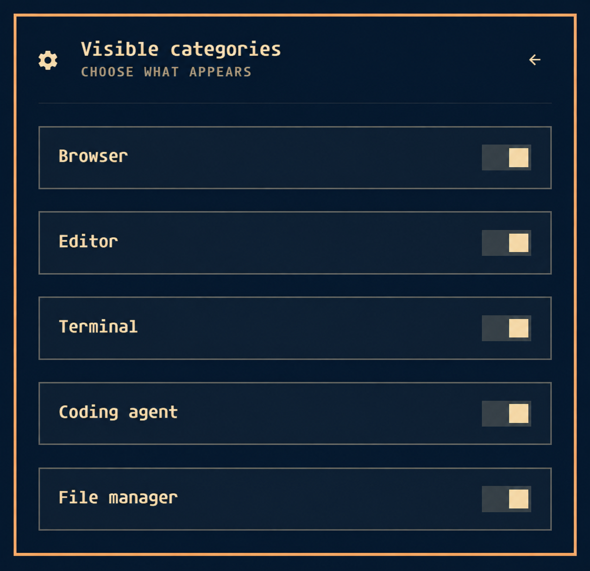

# Default Apps for Omarchy

Choose your default browser, editor, terminal, coding agent, and file manager
from a native Omarchy bar panel. The controls follow your active shell theme,
and you can choose which categories appear.

**Your defaults change only when you select a different application.**
Enabling, opening, refreshing, disabling, or removing the plugin does not
change them.


## Requirements

- Omarchy Quattro with the Quickshell plugin system and shared `qs.Ui` controls.
- Omarchy's `default browser`, `default editor`, `default terminal`, and
  `default agent` commands.
- Python 3 and xdg-utils.

Older Waybar-based Omarchy releases are not supported.

## Install

```sh
omarchy plugin add https://github.com/reinno/omarchy-default-apps --enable
```

If you previously installed a manual copy, remove it with
`omarchy plugin remove reinno.default-apps` before installing the Git-managed
version. Your chosen default apps remain unchanged.

Click the settings icon in the bar to open the panel. To place it on the right:

```sh
omarchy bar move reinno.default-apps --section right
```

## Use the panel

Select an application to make it the default. Changes apply immediately.
Reopen the panel or click its refresh icon to read changes made elsewhere.

Use Tab to focus controls, Enter to open a dropdown, and arrow keys to navigate
its options. Press Enter to select or Escape to dismiss it.

### Choose visible categories

Click the settings icon **inside the panel header** to open **Visible categories**.
Toggle categories there; changes save immediately. Use the back arrow or
Escape to return to the app selectors.



All five categories are visible by default. Hiding a category only hides its
selector; it does not change the default app. You can hide every category and
still use the settings button to bring them back.

The same options are available in Omarchy's widget settings and from the CLI:

```sh
omarchy bar set reinno.default-apps showAgent false --json
omarchy bar set reinno.default-apps showFileManager false --json
```

| Category | Setting key |
| --- | --- |
| Browser | `showBrowser` |
| Editor | `showEditor` |
| Terminal | `showTerminal` |
| Coding agent | `showAgent` |
| File manager | `showFileManager` |

Use `true` to show a category again. These settings are stored in Omarchy's
bar configuration and survive plugin updates.

## What each selection changes

| Category | Behavior |
| --- | --- |
| Browser | Uses Omarchy's default-browser command to update browser handlers. |
| Editor | Sets the editor used by `omarchy launch editor`; document associations are unchanged. |
| Terminal | Uses Omarchy's default-terminal command, which replaces the terminal preference list with the selected terminal. |
| Coding agent | Saves `~/.config/omarchy/defaults/agent` without installing or launching an agent. |
| File manager | Sets the `inode/directory` folder association; existing keyboard shortcuts are unchanged. |

Browser, editor, terminal, and agent choices are supported commands found on
PATH. Agent launcher wrappers can appear even when the underlying runtime has
not been installed. Flatpak-only applications and custom entries are not
supported for these categories.

File managers are discovered from XDG desktop entries that advertise
`inode/directory`, including custom entries.

The plugin has been tried locally. Coverage across themes, display scaling,
and multiple monitors is still limited.

### Optional file-manager shortcuts

Omarchy's stock Super+Shift+F and Super+Alt+Shift+F shortcuts launch Nautilus.
The plugin does not edit these bindings. To make them follow your folder
default, first inspect your current bindings:

```sh
omarchy menu keybindings --print
```

Back up `~/.config/hypr/bindings.lua`, then add the following if you want to
replace the actions currently assigned to those keys:

```lua
hl.unbind("SUPER + SHIFT + F")
o.bind("SUPER + SHIFT + F", "Default file manager", [[xdg-open "$HOME"]])
hl.unbind("SUPER + ALT + SHIFT + F")
o.bind("SUPER + ALT + SHIFT + F", "Default file manager (cwd)", [[xdg-open "$(omarchy-cmd-terminal-cwd)"]])
```

Apply and check the configuration:

```sh
hyprctl reload
hyprctl configerrors
```

To undo this integration, restore your backed-up bindings and reload Hyprland.

## Update, disable, or remove

Update a Git-managed installation:

```sh
omarchy plugin update reinno.default-apps
```

Hide the plugin without removing it:

```sh
omarchy plugin disable reinno.default-apps
```

Remove it:

```sh
omarchy plugin remove reinno.default-apps
```

Your chosen default apps remain in place after disabling or removing the
plugin. Optional file-manager keybindings also remain until you remove them.

## Local development

From a checkout of this repository, validate the manifest and read current
defaults:

```sh
omarchy plugin validate .
python3 defaults.py
```

Neither command changes default apps. To install a local copy:

```sh
mkdir -p ~/.config/omarchy/plugins/reinno.default-apps
cp manifest.json Panel.qml defaults.py ~/.config/omarchy/plugins/reinno.default-apps/
omarchy-shell shell rescanPlugins
omarchy plugin enable reinno.default-apps --section right
```

After editing files in the checkout, copy them into the plugin directory again.
Omarchy hot-reloads changes saved there. Use `rescanPlugins` after changing the
manifest if the updated metadata is not picked up.

## License

MIT. See [LICENSE](LICENSE).
