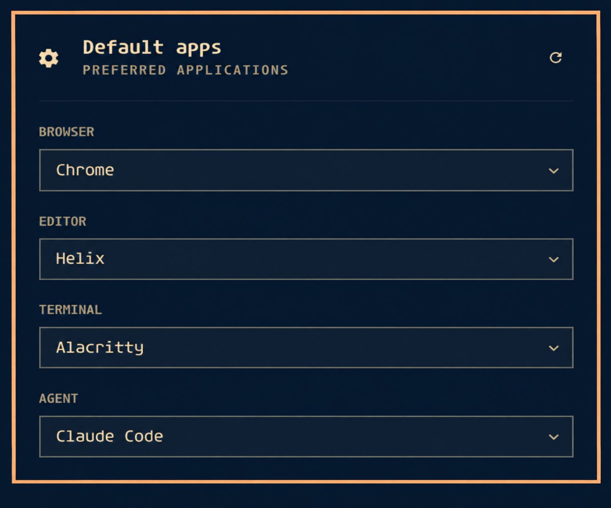

# Default Apps for Omarchy

A native Omarchy bar panel for choosing your default browser, editor,
terminal, coding agent, and file manager. Uses Omarchy's themed controls and follows the
active shell theme. Defaults change only when you select an application.



## Requirements

Omarchy Quattro with its Quickshell plugin system, the shared `qs.Ui`
components, `omarchy default browser/editor/terminal/agent`, Python 3, and xdg-utils.
Older Waybar-based Omarchy releases are not supported.

## Install

```sh
omarchy plugin add https://github.com/reinno/omarchy-default-apps --enable
```

Click the settings icon in the bar. To move it:

```sh
omarchy bar move reinno.default-apps --section right
```

Reopen the panel or use its refresh icon to detect external changes.
Tab focuses controls; Enter opens a dropdown, arrow keys choose an option,
and Escape closes it.

## Behavior and limitations

- Browser and terminal selections use Omarchy's default commands and their
  configuration behavior. The terminal command replaces the terminal
  preference list with the selected terminal.
- Editor selection controls `omarchy launch editor`, not every document
  MIME association.
- Agent selection writes `~/.config/omarchy/defaults/agent` atomically. It
  does not call the setter that would install or launch an agent.
- Choices are supported commands found on PATH. Agent launcher wrappers may
  appear even when their underlying runtime has not been installed.
- Browser/editor/terminal choices do not support Flatpak-only applications or custom entries. File managers are discovered from XDG desktop entries advertising `inode/directory`, including custom entries.
- File-manager selection changes only the folder association; existing keyboard shortcuts remain untouched.
- This initial release has been tried locally. Broader theme, scaling, and
  multi-monitor coverage is still limited.

## Update and remove

```sh
omarchy plugin update reinno.default-apps
omarchy plugin disable reinno.default-apps
omarchy plugin remove reinno.default-apps
```

Removing the plugin leaves your chosen defaults in place. Change them using
Omarchy's settings or commands if needed.

## Local development

```sh
omarchy plugin validate .
python3 defaults.py
mkdir -p ~/.config/omarchy/plugins/reinno.default-apps
cp manifest.json Panel.qml defaults.py ~/.config/omarchy/plugins/reinno.default-apps/
omarchy-shell shell rescanPlugins
omarchy plugin enable reinno.default-apps --section right
```

`python3 defaults.py` only reads preferences. Saved plugin changes hot-reload.
If you previously installed a manual copy, remove that copy with Omarchy's
plugin removal command before installing the Git-managed version.

## License

MIT. See [LICENSE](LICENSE).

## Optional file-manager shortcuts

Omarchy's stock Super+Shift+F and Super+Alt+Shift+F shortcuts launch Nautilus.
To make them follow the folder default, first inspect your existing bindings
with `omarchy menu keybindings --print`. If you want to replace them, add the
following to `~/.config/hypr/bindings.lua` (back up that file first):

```lua
hl.unbind("SUPER + SHIFT + F")
o.bind("SUPER + SHIFT + F", "Default file manager", [[xdg-open "$HOME"]])
hl.unbind("SUPER + ALT + SHIFT + F")
o.bind("SUPER + ALT + SHIFT + F", "Default file manager (cwd)", [[xdg-open "$(omarchy-cmd-terminal-cwd)"]])
```

Run `hyprctl reload` and `hyprctl configerrors` after editing. These optional
bindings replace any custom actions on those keys. The plugin never edits
Hyprland configuration. To undo, remove the added bindings and restore your
backup. The preview currently shows the earlier four-category panel.
